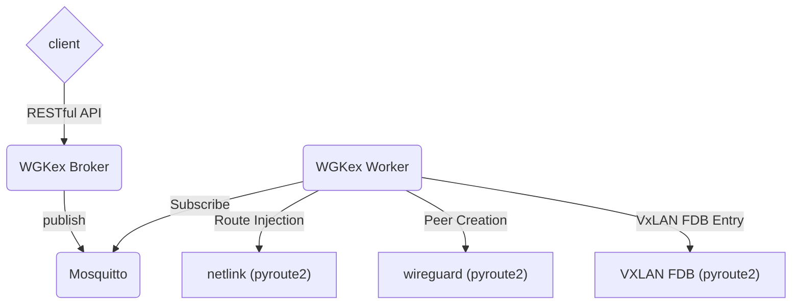

# WGKex

[](https://coveralls.io/github/freifunkMUC/wgkex?branch=main)
[](https://github.com/freifunkMUC/wgkex/actions/workflows/pylint.yml)
[](https://github.com/freifunkMUC/wgkex/actions/workflows/black.yml)
[](https://github.com/freifunkMUC/wgkex/actions/workflows/bazel.yml)

- [WGKex](#wgkex)
  - [Overview](#overview)
    - [Frontend broker](#frontend-broker)
    - [Backend worker](#backend-worker)
  - [Installation](#installation)
  - [Configuration](#configuration)
  - [Development](#development)
    - [Build using Bazel](#build-using-bazel)
    - [Updating PIP dependencies for Bazel](#updating-pip-dependencies-for-bazel)
    - [Unit tests](#unit-tests)
    - [Run Worker \& Broker using Bazel](#run-worker--broker-using-bazel)
    - [Run Worker \& Broker using Python](#run-worker--broker-using-python)
    - [Client](#client)
    - [MQTT topics](#mqtt-topics)
  - [Contact](#contact)

wgkex was started as a WireGuard key exchange tool, but has evolved beyond to the main node management tool of FFMUC.

## Overview

WireGuard Key Exchange is a tool consisting of two parts: a frontend (broker) and a backend (worker). These components
communicate to each other via MQTT - a messaging bus.



### Frontend broker

The frontend broker is where the client can push (register) its key before connecting. These keys are then pushed into
an MQTT bus for the workers to consume: keys received via `/api/v1` are sent to all workers (the client picks a gateway
itself), keys received via `/api/v2` only to the worker chosen for the client (`load_balancing.targeted_publish`,
enabled by default). When a key moves to a different worker, the broker asks the previous worker to remove the peer
immediately, instead of waiting for the stale peer cleanup.

Workers before this change subscribe to `wireguard/{domain}/+` and add every key, newer workers only act on keys for
`all` and their own hostname. Brokers before this change publish every key to `all`. Mixed versions therefore keep
working, the bandwidth savings only apply once both sides are updated.

The frontend broker exposes the following API endpoints for use:

```
/api/v1/wg/key/exchange
/api/v2/wg/key/exchange
```

The full API, including all response codes, is specified as OpenAPI 3 in [Docs/openapi.yaml](Docs/openapi.yaml)
(view it with e.g. the [Swagger Editor](https://editor.swagger.io/)). It is the reference for other client and broker
implementations, and `//wgkex/broker:openapi_test` checks that the broker's responses match it.

The listen address and port for the Flask server can be configured in `wgkex.yaml` under the `broker_listen` key:

```yaml
broker_listen:
  # host defaults to 127.0.0.1 if unspecified
  host: 0.0.0.0
  # port defaults to 5000 if unspecified
  port: 5000
```

#### POST /api/v1/wg/key/exchange

JSON POST'd to this endpoint should be in this format:

```json
{
  "domain": "CONFIGURED_DOMAIN",
  "public_key": "PUBLIC_KEY"
}
```

The broker will validate the domain and public key, and if valid, will push the key onto the MQTT bus.


#### POST /api/v2/wg/key/exchange

JSON POST'd to this endpoint should be in this format:

```json
{
  "domain": "CONFIGURED_DOMAIN",
  "public_key": "PUBLIC_KEY",
  "location": "OPTIONAL_LOCATION"
}
```

`location` is optional; workers with the same `location` in the `workers` config are preferred (see below).

The broker will validate the domain and public key, and if valid, will push the key onto the MQTT bus.
Additionally it chooses a worker (aka gateway, endpoint) that the client should connect to.
The response is JSON data containing the connection details for the chosen gateway:

```json
{
  "Endpoint": {
    "Address": "GATEWAY_ADDRESS",
    "Port": "GATEWAY_WIREGUARD_PORT",
    "AllowedIPs": [
      "GATEWAY_WIREGUARD_INTERFACE_ADDRESS"
    ],
    "PublicKey": "GATEWAY_PUBLIC_KEY"
  }
}
```

Additional fields may be added to these responses in the future, but the existing fields will not be changed,
as clients like the Gluon package `ffmuc-mesh-vpn-wireguard-vxlan` rely on them.

#### Rate limiting, block- and allowlists

Both endpoints are rate limited per client address (IPv6 per /64 by default) and globally (`rate_limit` config).
A limited request still gets the normal `200` response, because Gluon clients fall back to `/api/v1` and a random
gateway on errors. The key is just not published again, and `/api/v2` answers with the worker the key was already
assigned to (if it is still online), so repeated requests are a no-op.

#### Client address behind a reverse proxy

By default, the client address is the TCP peer address. Behind a reverse proxy that would be the proxy for every
request, so set `broker.trusted_proxies` to take it from `X-Forwarded-For`. The header can be spoofed by any client, so
it is only used from trusted proxies:

- A list of proxy addresses/networks (e.g. `["127.0.0.1/32", "::1/128"]`): the header is only used if the TCP peer is
  in one of them. It is evaluated from the right, skipping trusted proxies, and the first other address is the
  client. Entries further left were sent by the client and are ignored.
- A number `n` of proxies every request passes through: the `n`-th entry from the right is used, like werkzeug's
  `ProxyFix(x_for=n)`. Only use this if the broker can't be reached without passing the proxies.

The resolved address is used for rate limiting and, with `broker.log_client_ip: true` (off by default), it is logged
at INFO level with the domain and key of every key exchange request (`..., Client: 192.0.2.1`).

Keys on the blocklist (`key_lists.blocklist` / `blocklist_file`) are rejected with `403` and never published; keys newly
added to the file are also removed from all workers. Keys on the allowlist (`key_lists.allowlist` / `allowlist_file`,
worker config) are never removed from a worker by the stale peer cleanup, rebalancing or draining. Both files are
reloaded without a restart when modified.

#### Load balancing

For `/api/v2`, the broker chooses among the workers that are online for the requested domain and have published their
connection data. Each worker gets a target share of all peers according to its `weight` in the `workers` config.
The worker is picked randomly, with a probability proportional to how far it is below its target. Randomization avoids
that all clients reconnecting after a gateway outage (or talking to different broker instances) land on the same worker.

Workers only report peers with a recent handshake as connected. To bridge the time until a newly assigned peer shows up
in these metrics, the broker counts recent assignments as pending load of the chosen worker
(`load_balancing.pending_assignment_ttl`).

Clients stay connected to their gateway as long as the connection works, so after a gateway reboot the load would stay
uneven. Optionally (`load_balancing.rebalancing.enabled` on the broker *and* the workers), the broker periodically
tells overloaded workers how many peers they have above their target (after the set of online workers has been stable for
`stable_time`). These workers then remove a small, rate-limited number of their peers per interval, preferring the most
recently (re-)connected ones and never evicting the same peer again within `eviction_cooldown`. The affected clients
notice the broken connection and request a new gateway via the API within a minute or two.
See [wgkex.yaml.example](wgkex.yaml.example) for all options.

If the client sends a `location` and workers are configured with that location, these are preferred as long as their
effective peers stay within `target + max(location_min_excess_peers, location_tolerance * target)`; beyond that, the
normal selection applies. Keep `location_tolerance` at or below `rebalancing.tolerance`.

When running multiple broker instances behind a load balancer, enable `load_balancing.share_pending_assignments` on all
of them: each assignment is then published on `wireguard-broker/{broker_id}/assignment` and counted as pending by the
other brokers as well.

Workers only announce themselves as online once all their WireGuard interfaces are ready. A worker is treated as offline
for a domain if the broker did not receive a connected peers metric for it within `load_balancing.metrics_max_age`
seconds (default 180, i.e. three metrics intervals). Workers missing from the `workers` config get the average weight.

### Backend worker

The backend (worker) waits for new keys to appear on the MQTT message bus. Once a new key appears, the worker performs
validation task on the key, then injects those keys into a WireGuard instance(While also updating the VxLAN FDB).
It reports metrics like number of connected peers and instance data like local address, WG listening port and
external domain name (configured in config.yml) back to the broker.
Each worker must run on a machine with a unique hostname, as it is used for separation of metrics.
On SIGINT or SIGTERM (e.g. `docker stop`), the worker marks itself offline at the broker before exiting.
Peers without a handshake for `peer_cleanup.stale_timeout` seconds (default 1800) are removed every
`peer_cleanup.interval` seconds (default 300). Peers which were just added are kept until they had time to connect.
Queued key operations are picked up immediately (blocking queue, processed in batches of up to 256), and each worker
thread keeps its netlink sockets and interface indexes open instead of reconnecting per operation. Broken sockets are
reopened and recreated interfaces looked up again automatically. WireGuard peers are still added one per netlink
message, as pyroute2's `WireGuard.set()` accepts only a single peer.

#### Drain mode and planned reboots

A worker can be put into drain mode before planned maintenance:

- `kill -USR1 <pid>` (or `docker kill -s USR1 <container>`) starts draining, `kill -USR2 <pid>` stops it.
- Alternatively configure `drain.file` (e.g. `/run/wgkex/drain`): the worker is draining while that file exists,
  checked every `drain.check_interval` seconds (default 5). Use a non-persistent location like `/run`, so the worker
  does not come back up draining after the reboot. SIGUSR2 does not override an existing drain file.

A draining worker publishes status `2`. The broker then stops assigning new v2 clients to it (unless every worker of a
domain is draining, clients always get an endpoint). If active rebalancing is enabled on broker and worker, the broker
also asks the draining worker to evict its connected peers at `load_balancing.rebalancing.drain_rate` (default 10%)
of its peers per `interval`, without waiting for `stable_time`, and only in domains where another worker which is not
draining is online. Evicted nodes notice the broken tunnel within about 1-2 minutes and redo the key exchange, which
assigns them to another worker. Brokers from before drain mode treat status `2` like `1`.

Planned reboot runbook:

1. Start draining: `docker kill -s USR1 <worker container>` or `touch /run/wgkex/drain`. The worker logs
   `Worker is draining, published status 2`.
2. Wait until the connected peers metric (`wireguard-metrics/{domain}/{worker}/connected_peers`) is close to 0.
   With the defaults (`interval: 60`, `drain_rate: 0.1`) roughly 90% of the peers are gone after 20 minutes. Without
   rebalancing, peers stay until the reboot, but no new ones arrive.
3. Reboot. On shutdown (SIGTERM) the worker publishes status `0`, the LWT does the same if it is killed.
4. After the boot the worker publishes status `1` once its WireGuard interfaces are ready (drain file in `/run` is
   gone, signals are not persisted). If a drain file in a persistent location was used, delete it.
5. Normal rebalancing (if enabled) moves peers back to the rebooted worker after `stable_time`.

### Prometheus metrics

The broker serves metrics in the Prometheus text format at `GET /metrics` on its normal HTTP listener. Disable it with
`metrics.broker_endpoint: false`, or keep the path from being reachable through your reverse proxy if the worker loads
should not be public. It exports:

| Metric | Labels | Description |
|---|---|---|
| `wgkex_broker_worker_online` | `worker` | 1 if the worker is online |
| `wgkex_broker_worker_draining` | `worker` | 1 if the worker is draining |
| `wgkex_broker_worker_connected_peers` | `worker` | Connected peers reported by the worker (all domains) |
| `wgkex_broker_worker_pending_assignments` | `worker` | Assigned peers not yet reflected in the worker's metrics |
| `wgkex_broker_worker_effective_peers` | `worker` | Connected peers plus pending assignments, used for selection |
| `wgkex_broker_worker_target_peers` | `worker` | Weighted share of the effective peers of all online, non-draining workers |
| `wgkex_broker_worker_domain_online` | `worker`, `domain` | 1 if the worker is online for the domain with fresh metrics |
| `wgkex_broker_worker_domain_connected_peers` | `worker`, `domain` | Connected peers reported for the domain |
| `wgkex_broker_key_exchange_requests_total` | `api` (`v1`, `v2`), `result` (`ok`, `invalid`, `blocked`, `rate_limited`, `no_worker`, `no_worker_data`) | Key exchange requests |
| `wgkex_broker_assignments_total` | `worker`, `domain` | Peers assigned by the v2 key exchange |
| `wgkex_broker_rebalance_hints_total` | `worker`, `kind` (`rebalance`, `drain`) | Published rebalancing hints |
| `wgkex_broker_rebalance_hint_excess_peers_total` | `worker`, `kind` | Sum of the excess peers in published hints |
| `wgkex_broker_shared_assignments_received_total` | | Assignments received from other broker instances |
| `wgkex_broker_mqtt_message_errors_total` | `handler` (`metrics`, `status`, `data`, `assignment`) | Ignored invalid MQTT messages |

Workers can serve metrics on a separate HTTP listener (`GET /metrics`), which is disabled unless `metrics.worker_port`
is set (bind address `metrics.worker_host`, default `0.0.0.0`):

| Metric | Labels | Description |
|---|---|---|
| `wgkex_worker_queue_depth` | | Peer operations waiting in the queue |
| `wgkex_worker_peer_operations_total` | `op` (`add`, `remove`), `result` (`ok`, `error`) | Processed peer operations |
| `wgkex_worker_netlink_operation_seconds` | `op` (`wg_set`, `wg_info`, `route`, `fdb`, `get_addr`) | Histogram of netlink operation durations |
| `wgkex_worker_netlink_reconnects_total` | | Netlink sockets reopened after an error |
| `wgkex_worker_evictions_total` | `kind` (`rebalance`, `drain`) | Peers evicted on request of the broker |

#### Grafana dashboards

[contrib/grafana](contrib/grafana) contains example dashboards with the same panels for two setups:

- [wgkex-prometheus.json](contrib/grafana/wgkex-prometheus.json): for a Prometheus datasource scraping the broker and
  worker `/metrics` endpoints.
- [wgkex-influxdb.json](contrib/grafana/wgkex-influxdb.json): for an InfluxDB (1.x, InfluxQL) datasource, filled by
  Telegraf's `inputs.prometheus` plugin with `metric_version = 2` (measurement `prometheus`). See
  [telegraf-wgkex.conf](contrib/grafana/telegraf-wgkex.conf); the dashboard expects the tag `wgkex_role = "worker"` on
  the worker inputs. Histograms can't be aggregated into percentiles in InfluxQL, so netlink latency is shown as mean.

Import them via *Dashboards → New → Import* and choose the datasource for the `DS` variable. The `worker` and `domain`
variables filter the broker panels; `instance` (Prometheus) / `url` (InfluxDB) filters the worker panels.
Panels cover effective peers against the weighted target, connected peers per domain, pending assignments,
online/draining state, assignments per worker, rebalancing hints and evictions, request rates and errors, rate limited and
blocked requests, worker queue depth, peer operations and netlink latency/reconnects. Rate limited and blocked requests
are only reported by brokers that support rate limiting and blocklists.

This tool is intended to facilitate running BATMAN over VXLAN over WireGuard as a means to create encrypted
high-performance mesh links.

For further information, please see this [presentation on the architecture](https://www.slideshare.net/AnnikaWickert/ffmuc-goes-wild-infrastructure-recap-2020-rc3)

## Installation

- TBA

## Configuration

- Configuration file

The `wgkex` configuration file defaults to `/etc/wgkex.yaml` ([Sample configuration file](wgkex.yaml.example)), however
can also be overwritten by setting the environment variable `WGKEX_CONFIG_FILE`.

The log level is set with `log_level` (default `INFO`), a full Python logging configuration can be given in
`logging_config`.

## Development

### Build using [Bazel](https://bazel.build)

```sh
# modify .bazelversion if you want to test another version of Bazel (using Bazelisk)
bazel build //wgkex/broker:app
bazel build //wgkex/worker:app
# artifacts will be at ./bazel-bin/wgkex/{broker,worker}/app respectively
```

### Updating PIP dependencies for Bazel

This package is using Bazel's `compile_pip_requirements` to get a requirements_lock.txt file.
In order to update the respective depencencies after modifying the requirements.txt, run:

```sh
bazel run //:requirements.update
```

### Unit tests

The test can be run using

```sh
bazel test ... --test_output=all
```

or

```sh
python3 -m unittest discover -p '*_test.py'
```

### Run Worker & Broker using Bazel

1. After having built the broker and worker (see above),
   set up dummy interfaces for the worker using this script:

   ```sh
   interface_linklocal() {
     # We generate a predictable v6 address
     local macaddr="$(echo $1 | wg pubkey |md5sum|sed 's/^\(..\)\(..\)\(..\)\(..\)\(..\).*$/02:\1:\2:\3:\4:\5/')"
     local oldIFS="$IFS"; IFS=':'; set -- $macaddr; IFS="$oldIFS"
     echo "fe80::$1$2:$3ff:fe$4:$5$6"
   }

   sudo ip link add wg-welt type wireguard
   wg genkey | sudo wg set wg-welt private-key /dev/stdin
   sudo wg set wg-welt listen-port 51820
   addr=$(interface_linklocal $(sudo wg show wg-welt private-key))
   sudo ip addr add $addr dev wg-welt
   sudo ip link add vx-welt type vxlan id 99 dstport 0 local $addr dev wg-welt
   sudo ip addr add fe80::1/64 dev vx-welt
   sudo ip link set wg-welt up
   sudo ip link set vx-welt up
   ```

2. Generate a development configuration:

   ```sh
   sed -E '/(ffmuc_muc|ffwert|ffdon)/d' wgkex.yaml.example > wgkex.yaml
   ```

3. Run the broker in a terminal:

   ```sh
   # defaults to /etc/wgkex.yaml if not set
   export WGKEX_CONFIG_FILE=$PWD/wgkex.yaml
   ./bazel-bin/wgkex/broker/app
   ```

4. And run the worker in a second terminal:

   ```sh
   export WGKEX_CONFIG_FILE=$PWD/wgkex.yaml
   # the worker requires admin permissions to read interfaces
   sudo -E ./bazel-bin/wgkex/worker/app
   ```

### Run Worker & Broker using Python

Follow steps above to set generate the new config and export the `WGKEX_CONFIG_FILE`
then start the broker and worker like the following:

- Broker (Using Flask development server)

  ```sh
  FLASK_ENV=development FLASK_DEBUG=1 FLASK_APP=wgkex/broker/app.py python3 -m flask run
  ```

- Worker

  ```sh
  python3 -c 'from wgkex.worker.app import main; main()'
  ```

### Client

The client can be used via CLI:

```sh
wget -q -O- --post-data='{"domain": "ffmuc_welt","public_key": "o52Ge+Rpj4CUSitVag9mS7pSXUesNM0ESnvj/wwehkg="}' 'http://127.0.0.1:5000/api/v2/wg/key/exchange'
```

and it should output something similar to:

```json
{
  "Endpoint": {
    "Address": "gw04.ext.ffmuc.net",
    "AllowedIPs": [
      "fe80::27c:16ff:fec0:6c74"
    ],
    "Port": "40011",
    "PublicKey": "TszFS3oFRdhsJP3K0VOlklGMGYZy+oFCtlaghXJqW2g="
  }
}
```

Or use Python instead of wget:

```python
import requests
key_data = {"domain": "ffmuc_welt","public_key": "o52Ge+Rpj4CUSitVag9mS7pSXUesNM0ESnvj/wwehkg="}
broker_url = "http://127.0.0.1:5000"
push_key = requests.get(f'{broker_url}/api/v2/wg/key/exchange', json=key_data)
print(f'Key push was: {push_key.json().get("Message")}')
```

### MQTT topics

- Publishing keys broker->worker: `wireguard/{domain}/{worker}`, `{worker}` is `all` for v1 keys and the chosen worker's
  hostname for v2 keys
- Removing peers broker->worker (when a key moved to another worker): `wireguard-worker/{worker}/{domain}/remove`,
  payload is the public key
- Publishing metrics worker->broker: `wireguard-metrics/{domain}/{worker}/connected_peers`
- Publishing worker status: `wireguard-worker/{worker}/status`, retained, `0` offline, `1` online, `2` draining
  (brokers from before drain mode treat any value >= 1 as online)
- Publishing worker data: `wireguard-worker/{worker}/{domain}/data`
- Rebalancing hints broker->worker (only if rebalancing is enabled): `wireguard-worker/{worker}/rebalance`,
  JSON `{"excess": int, "domains": [...]}`, plus `"max_evictions_ratio": float` for draining workers
- Sharing assignments broker->broker (only if `share_pending_assignments` is enabled):
  `wireguard-broker/{broker_id}/assignment`, JSON `{"worker": str, "domain": str, "key": str}`

## Contact

[Freifunk Munich Mattermost](https://chat.ffmuc.net)
