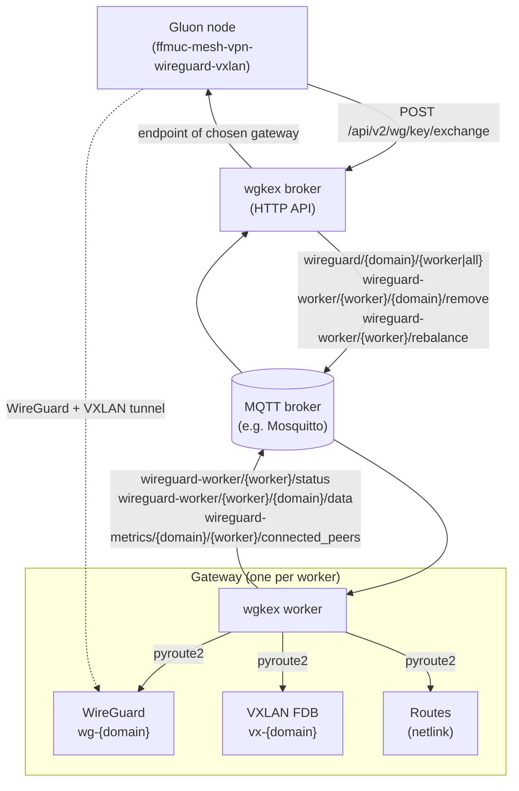

# wgkex

[](https://github.com/freifunkMUC/wgkex/actions/workflows/bazel.yml)
[](https://github.com/freifunkMUC/wgkex/actions/workflows/pylint.yml)
[](https://github.com/freifunkMUC/wgkex/actions/workflows/black.yml)
[](https://coveralls.io/github/freifunkMUC/wgkex?branch=main)
[](https://github.com/freifunkMUC/wgkex/pkgs/container/wgkex)
[](LICENSE)

**wgkex** (WireGuard key exchange) is the node management service of [Freifunk München](https://ffmuc.net). Mesh nodes
register their WireGuard public key with a central **broker**, which picks a gateway for them and distributes the key
via MQTT to the **workers** running on the gateways. The workers add the peer to WireGuard and the VXLAN FDB, so that
nodes can run BATMAN over VXLAN over WireGuard as encrypted, high-performance mesh links.

On the node side, wgkex is used by the Gluon package
[`ffmuc-mesh-vpn-wireguard-vxlan`](https://github.com/freifunk-gluon/community-packages/tree/main/ffmuc-mesh-vpn-wireguard-vxlan).

## Contents

- [Architecture](#architecture)
- [Quick start](#quick-start)
  - [Docker](#docker)
  - [Bazel](#bazel)
  - [Python](#python)
- [Configuration](#configuration)
- [API](#api)
- [Operations](#operations)
- [MQTT topics](#mqtt-topics)
- [Development](#development)
- [Contributing](#contributing)
- [License](#license)

## Architecture



- **Broker** (`wgkex/broker`): a Flask app served by waitress. It validates key exchange requests, chooses a gateway
  weighted by load (`/api/v2`), and publishes the key via MQTT. It also serves Prometheus metrics and runs the optional
  rebalancing loop.
- **Worker** (`wgkex/worker`): runs on each gateway. It subscribes to the keys for its domains and adds them as
  WireGuard peers, routes and VXLAN FDB entries via netlink (pyroute2). It reports its status, endpoint data and
  connected peers back to the broker, removes stale peers, and supports drain mode for planned maintenance.
- WireGuard and VXLAN interface names are derived from the domain: the matching `domain_prefixes` entry is replaced by
  `wg-` / `vx-` (e.g. `ffmuc_welt` → `wg-welt`, `vx-welt`).

> [!IMPORTANT]
> Every worker must run on a host with a **unique hostname**. The hostname identifies the worker in the MQTT topics,
> in the `workers` config and in the metrics.

The broker publishes `/api/v1` keys to all workers and `/api/v2` keys only to the chosen worker; see
[MQTT topics](#mqtt-topics) and [Docs/operations.md](Docs/operations.md) for details.

## Quick start

All components read their configuration from `/etc/wgkex.yaml`, or from the file in the environment variable
`WGKEX_CONFIG_FILE`. Start from [`wgkex.yaml.example`](wgkex.yaml.example).

### Docker

Images are published to [`ghcr.io/freifunkmuc/wgkex`](https://github.com/freifunkMUC/wgkex/pkgs/container/wgkex) on
every push to `main` (tags `main` and `sha-<commit>`) and for release tags `vX.Y.Z`. The image command selects the
component (`broker`, the default, or `worker`):

```sh
docker run -d --name wgkex-broker -p 5000:5000 \
  -v "$PWD/wgkex.yaml:/etc/wgkex.yaml:ro" \
  ghcr.io/freifunkmuc/wgkex:main broker
```

[`docker-compose.yml`](docker-compose.yml) starts Mosquitto, a broker and a worker. Without a mounted
`/etc/wgkex.yaml`, the [`entrypoint`](entrypoint) generates a minimal config from the environment variables in
[`env.example`](env.example) (`WGKEX_DOMAINS`, `WGKEX_DOMAIN_PREFIXES`, `WGKEX_DEBUG`,
`WGKEX_BROKER_LISTEN_HOST`/`_PORT` (default `0.0.0.0:5000`), `MQTT_*`). `WGKEX_IMAGE_TAG` selects the image tag
(default `main`; the `latest` tag still points to v0.2.1).
[`docker-compose.override.yaml.example`](docker-compose.override.yaml.example) shows how to mount configs or disable
services.

> [!NOTE]
> The worker manages WireGuard and VXLAN interfaces of the host via netlink. It needs the host's network namespace and
> `CAP_NET_ADMIN` (e.g. `--network host --cap-add NET_ADMIN`), and the interfaces must already exist.

### Bazel

```sh
bazel build //wgkex/broker:app //wgkex/worker:app
export WGKEX_CONFIG_FILE=$PWD/wgkex.yaml
./bazel-bin/wgkex/broker/app
# the worker needs root (or CAP_NET_ADMIN) to manage the interfaces
sudo -E ./bazel-bin/wgkex/worker/app
```

[Bazelisk](https://github.com/bazelbuild/bazelisk) picks the Bazel version from [`.bazelversion`](.bazelversion).
See [Docs/development.md](Docs/development.md) for a local setup with dummy interfaces.

### Python

Bazel uses Python 3.13 (see [`MODULE.bazel`](MODULE.bazel)). To run from a checkout without Bazel:

```sh
python3 -m venv .venv && . .venv/bin/activate
pip install -r requirements_lock.txt
export WGKEX_CONFIG_FILE=$PWD/wgkex.yaml
python3 -m wgkex.broker.app
sudo -E .venv/bin/python3 -m wgkex.worker.app
```

## Configuration

[`wgkex.yaml.example`](wgkex.yaml.example) is the source of truth: it documents every option with its default and
whether it applies to the broker, the worker or both. Overview:

| Key | Used by | Description |
|---|---|---|
| `domains` | broker, worker | Accepted domains; each needs matching `wg-*` / `vx-*` interfaces on the workers. Required. |
| `domain_prefixes` | broker, worker | Prefixes stripped from the domain to derive the interface names. Required. |
| `mqtt` | broker, worker | `broker_url`, `username`, `password` (required); `broker_port` (`1883`), `keepalive` (`5`), `tls` (`false`). |
| `broker_listen` | broker | `host` and `port` of the HTTP API. Both are required by the broker (no built-in default). |
| `externalName` | worker | Public hostname or address of this worker, returned to clients as `Endpoint.Address`. Defaults to the hostname. |
| `workers` | broker | Hostname → `weight` (default `1`) and optional `location` per worker. Unlisted workers get the average weight. |
| `load_balancing` | broker, worker | Peer distribution, targeted publishing, location preference, shared assignments and `rebalancing`. |
| `peer_cleanup` | worker | Removal of peers without handshake: `stale_timeout` (`1800` s), `interval` (`300` s). |
| `drain` | worker | Drain mode: `file` (unset), `check_interval` (`5` s). |
| `metrics` | broker, worker | `broker_endpoint` (`true`), `worker_port` (unset = disabled), `worker_host` (`0.0.0.0`). |
| `rate_limit` | broker | Per-client and global token buckets for the key exchange (`30`/`60` s per client, `6000`/`60` s global). |
| `broker` | broker | `trusted_proxies` (`0`) and `log_client_ip` (`false`). |
| `key_lists` | broker, worker | `blocklist`/`blocklist_file` (broker), `allowlist`/`allowlist_file` (worker), `reload_interval` (`60` s). |
| `log_level` | broker, worker | Root log level (`INFO`). Overrides the root level of `logging_config`. |
| `logging_config` | broker, worker | Optional Python logging configuration in `dictConfig` format. |

## API

The broker exposes:

| Endpoint | Description |
|---|---|
| `POST /api/v1/wg/key/exchange` | Publish a key to all workers of the domain; the client picks a gateway itself. |
| `POST /api/v2/wg/key/exchange` | Publish a key and get the connection data of the gateway chosen for the client. |
| `GET /api/v3/wg/key/exchange` | Parker only (`parker.enabled`): signed node configuration with one concentrator per PoP. Also served at `/api/v3/config` and `/config`. See [Docs/parker.md](Docs/parker.md). |
| `GET /metrics` | Prometheus metrics (unless `metrics.broker_endpoint: false`). |
| `GET /` | Static index page. |

[`Docs/openapi.yaml`](Docs/openapi.yaml) (OpenAPI 3) is the authoritative specification of requests, responses and
status codes, and the reference for other client and broker implementations. View it with e.g. the
[Swagger Editor](https://editor.swagger.io/); `//wgkex/broker:openapi_test` checks the broker against it.

```sh
curl -s -X POST http://127.0.0.1:5000/api/v2/wg/key/exchange \
  -d '{"domain": "ffmuc_welt", "public_key": "o52Ge+Rpj4CUSitVag9mS7pSXUesNM0ESnvj/wwehkg=", "location": "muc"}'
```

```json
{
  "Endpoint": {
    "Address": "gw04.ext.ffmuc.net",
    "Port": "40011",
    "AllowedIPs": ["fe80::27c:16ff:fec0:6c74"],
    "PublicKey": "TszFS3oFRdhsJP3K0VOlklGMGYZy+oFCtlaghXJqW2g="
  }
}
```

`location` is optional; workers configured with the same `location` are preferred.

Or for /api/v3 (Parker):
```sh
curl --get \
  --data-urlencode "v6mtu=1500" \
  --data-urlencode "pubkey=TszFS3oFRdhsJP3K0VOlklGMGYZy+oFCtlaghXJqW2g=" \
  --data-urlencode "nonce=123456" \
  "http://127.0.0.1:5000/api/v3/wg/key/exchange"
```

> [!IMPORTANT]
> Compatibility with the Gluon client `ffmuc-mesh-vpn-wireguard-vxlan` is part of the contract:
>
> - The request body is parsed as JSON regardless of the `Content-Type` header.
> - `Endpoint.Port` is a **string**, not a number.
> - On any non-`200` response, the client falls back to `/api/v1` and a random gateway from its own configuration.
>   Rate-limited requests therefore still get a `200` response; v1 and v2 never answer with `429`.
> - Parker (`/api/v3`) is purely additive and doesn't change v1 or v2.
> - New response fields may be added, but existing fields are never changed. Clients must ignore unknown fields.

## Operations

Detailed guides are in [Docs/operations.md](Docs/operations.md) and [Docs/metrics.md](Docs/metrics.md):

- [Load balancing and rebalancing](Docs/operations.md#load-balancing): weighted, randomized gateway selection with
  pending assignments, location preference, optional active rebalancing, and multiple broker instances.
- [Drain mode and planned reboots](Docs/operations.md#drain-mode-and-planned-reboots): `SIGUSR1`/`SIGUSR2` or a drain
  file, plus a step-by-step reboot runbook.
- [Stale peer cleanup and worker internals](Docs/operations.md#worker-peer-handling).
- [Rate limiting and key block-/allowlists](Docs/operations.md#rate-limiting-and-key-lists).
- [Running behind a reverse proxy](Docs/operations.md#running-behind-a-reverse-proxy): `broker.trusted_proxies` and
  `broker.log_client_ip`.
- [Parker](Docs/parker.md): `/api/v3`, PoPs, IPAM and Parker peer cleanup.
- [Prometheus metrics and Grafana dashboards](Docs/metrics.md): metric reference and the dashboards in
  [`contrib/grafana`](contrib/grafana) for Prometheus and InfluxDB/Telegraf.

> [!WARNING]
> `GET /metrics` on the broker exposes worker names and loads. Disable it with `metrics.broker_endpoint: false` or block
> the path at your reverse proxy if that should not be public.

## MQTT topics

All topics are defined in [`wgkex/common/mqtt.py`](wgkex/common/mqtt.py). `{worker}` is the worker's hostname.

| Topic | Direction | Payload | Notes |
|---|---|---|---|
| `wireguard/{domain}/{worker}` | broker → worker | public key | `{worker}` is `all` for `/api/v1` keys, and the chosen worker for `/api/v2` keys (with `load_balancing.targeted_publish`, the default). |
| `wireguard-worker/{worker}/{domain}/remove` | broker → worker | public key | Remove a peer whose key moved to another worker. |
| `wireguard-worker/{worker}/rebalance` | broker → worker | JSON `{"excess": int, "domains": [str]}` | Only with rebalancing enabled. Draining workers also get `"max_evictions_ratio": float`. |
| `wireguard-worker/{worker}/status` | worker → broker | `0` offline, `1` online, `2` draining | Retained. The worker's MQTT last will sets `0`. |
| `wireguard-worker/{worker}/{domain}/data` | worker → broker | JSON `{"ExternalAddress", "Port", "PublicKey", "LinkAddress"}` | Retained. Endpoint data returned by `/api/v2`. |
| `wireguard-metrics/{domain}/{worker}/connected_peers` | worker → broker | integer | Peers with a recent handshake, sent every 60 s. |
| `wireguard-broker/{broker_id}/assignment` | broker → broker | JSON `{"worker": str, "domain": str, "key": str}` | Only with `load_balancing.share_pending_assignments`. |
| `parker/wireguard/{worker}` | broker → worker | JSON `{"PublicKey", "Range6", "Keepalive"}`, optionally `"Remove": true` | Parker only. Sent to each concentrator chosen for a node; `Remove` to concentrators it was moved away from. Parker workers also accept `{worker}` = `all`. |
| `parker/wireguard-worker/{worker}/status` | worker → broker | `0` offline, `1` online, `2` draining | Parker only. Retained. |
| `parker/wireguard-worker/{worker}/data` | worker → broker | JSON `{"ExternalAddress", "Port", "PublicKey", "LinkAddress"}` | Parker only. Retained. |
| `parker/wireguard-metrics/{worker}/connected_peers` | worker → broker | integer | Parker only. Sent every 10 s. |

The `remove`, `rebalance` and `assignment` topics, the targeted `wireguard/{domain}/{worker}` keys and status `2` were
added without breaking older components, so brokers and workers can be upgraded one at a time:

- Older workers subscribe to `wireguard/{domain}/+` and add every key; newer workers only act on `all` and their own
  hostname. Older brokers publish every key to `all`. The bandwidth savings of targeted publishing only apply once both
  sides are updated.
- Older workers ignore `remove` and `rebalance` messages; older brokers ignore `assignment` messages.
- Older brokers treat any status `>= 1`, including draining (`2`), as online.

## Development

```sh
bazel build //...
# all tests, as run in CI
bazel test //... --test_output=errors --action_env=WGKEX_CONFIG_FILE=$PWD/wgkex.yaml.example
```

Without Bazel, run the test modules one at a time (they share module-level state, so a single
`unittest discover` run does not work):

```sh
export WGKEX_CONFIG_FILE=$PWD/wgkex.yaml.example
for t in $(git ls-files 'wgkex/*_test.py'); do python3 -m unittest "$(echo "${t%.py}" | tr / .)" || break; done
```

CI ([`.github/workflows`](.github/workflows)) runs the Bazel tests with coverage, `ruff check` on `./wgkex` (ruff is
pinned to **0.16.1**, so new default rules don't break CI) and `black --check` (the `psf/black` action, v26.5.1):

```sh
pip install ruff==0.16.1 black==26.5.1
ruff check ./wgkex
black --check .
```

Python dependencies are declared in [`requirements.txt`](requirements.txt) and locked in
[`requirements_lock.txt`](requirements_lock.txt) via Bazel's `compile_pip_requirements`. After changing
`requirements.txt`, regenerate the lock file:

```sh
bazel run //:requirements.update
```

> [!NOTE]
> The Bazel version in [`.bazelversion`](.bazelversion) must match the `bazel-public/bazel` builder image in the
> [`Dockerfile`](Dockerfile); a workflow updates `.bazelversion` on Dependabot pull requests.

See [Docs/development.md](Docs/development.md) for running broker and worker locally with dummy interfaces and
example clients.

## Contributing

Issues and pull requests are welcome. Please keep CI green (tests, ruff, black), add tests for new behaviour, and update
[`wgkex.yaml.example`](wgkex.yaml.example) and [`Docs/openapi.yaml`](Docs/openapi.yaml) when changing configuration or
the API. New MQTT topics and payload fields must stay compatible with older brokers and workers.

Questions? Reach us on the [Freifunk München Mattermost](https://chat.ffmuc.net). Background on the architecture:
[FFMUC goes wild – infrastructure recap 2020 (rC3)](https://www.slideshare.net/slideshow/ffmuc-goes-wild-infrastructure-recap-2020-rc3/240656823).

## License

wgkex is licensed under the [GNU General Public License v3.0](LICENSE).
